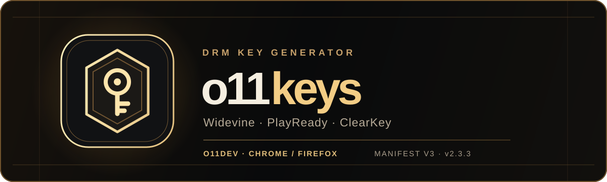

<div align="center">



**Drm Key Generator**

Built by **o11dev**

[Download Chrome build](https://github.com/drmforall/o11keys/releases/download/v2.3.3/o11keys-2.3.3.zip) · [Download Firefox build](https://github.com/drmforall/o11keys/releases/download/v2.3.3/o11keys-2.3.3-firefox.zip)

</div>

---

## The control center

o11keys is a Manifest V3 browser extension with a modern UI for Widevine, PlayReady, and ClearKey configuration. It supports local and remote device sources, per-site profiles, and a dedicated key viewer.

| Feature | What it does |
| --- | --- |
| ◇ Systems | Configure Widevine, PlayReady, and ClearKey per site. |
| ◇ Devices | Import local device files or configure a remote source. Local device files stay in browser-local storage. |
| ◇ Key viewer | Open a separate window with captured keys and MPD/HLS manifest URLs. |
| ◇ JSON export | Save readable JSON with the browser URL, captured page URLs, keys, and manifests. Filenames begin with the page title, followed by a safe version of its URL. |
| ◇ Commands | Choose quality and output options, add a manifest URL, and copy a generated command. |

## Install

### Chrome and Chromium browsers

1. Download the [Chrome ZIP](https://github.com/drmforall/o11keys/releases/download/v2.3.3/o11keys-2.3.3.zip) and extract it.
2. Open `chrome://extensions` and enable **Developer mode**.
3. Choose **Load unpacked** and select the extracted folder containing `manifest.json`.

### Firefox 121+

1. Download the [Firefox ZIP](https://github.com/drmforall/o11keys/releases/download/v2.3.3/o11keys-2.3.3-firefox.zip).
2. Open `about:debugging` → **This Firefox** → **Load Temporary Add-on**.
3. Select the ZIP file, then open o11keys from the extensions menu.

The Firefox ZIP is unsigned. Temporary loading ends when Firefox restarts. Permanent installation in standard Firefox requires Mozilla signing.

## Use

Open the o11keys toolbar button, select a system and device source, then configure a global or site profile. Saved key entries appear in the **Keys** section. Use **Open keys + MPD** to view a capture in its own window, or **Export** for a structured JSON file.

### Included devices

Download the device file you need, then open **Devices** in o11keys and import it as a local device:

| System | Device file |
| --- | --- |
| Widevine | [CVTE MT9602 L1](devices/cvte_mt9602_linux_14.0.0_a947440b_22326_l1_20261030_114804.wvd) |
| PlayReady | [Hisense Smart TV](devices/hisense_smarttv_he55a7000euwts_sl3000_0002.prd) |

These files include device credentials. Anyone with access to this public repository can download them.

Only use device files and content for which you have permission. JSON exports contain sensitive key material; store and share them carefully.

## Build from source

```sh
npm ci
npm test
npm run build
```

The build creates the Chrome and Firefox ZIPs in `dist/`. `npm run icons` regenerates the four extension icon states from original vector artwork in `artwork/`.

## License

o11keys is distributed under GPL-3.0-only. See [LICENSE](LICENSE) and [NOTICE](NOTICE) for the required source attribution and third-party terms.
